  

  

  
  
  
  
  
  

  A MIUI and HyperOS mod that brings a sleek, minimal interface and a clean system UI management layer,
  with useful features for both function and looks.

---

## Devices

| Device | Codename | Status |
| :--- | :--- | :--- |
| Xiaomi Redmi Note 11 | `spes` / `spesn` | 🟢 Released |
| Xiaomi Redmi Note 9, Pro, Max, Poco M2 | `miatoll` | 🟢 Released |
| Redmi K40, POCO F3, Mi 11X | `alioth` / `aliothin` | 🟢 Released |
| Xiaomi Redmi 10, 10C, 10 Power | `fog` / `rain` / `wind` | 🟡 Not yet |

## Features

| Feature | What it does |
| :--- | :--- |
| Dual status bar | Clock and battery on the top row, notifications and signal icons below |
| Pill tab bar | A floating, blurred navigation pill with a light-mode shadow |
| Dynamic Island | A status bar pill on the camera cutout that reacts to media, notifications, and charging |
| Custom clock | Custom fonts, marquee text, and hour and minute colors from settings |
| Charging pill | Animated gradient charging info on the lockscreen |
| Device info card | CPU, GPU, RAM, and battery details on the About phone page |
| Calmer animations | Battery, Wi-Fi, and network icon animations are off when Control Center expands |

## Release changelogs

| Edition | Date | Changelog | Devices |
| :--- | :--- | :--- | :--- |
| Griffin | 18 Oct 2024 | [View changelog](https://raw.githubusercontent.com/Fazokhan/NEXTOS_PROJECT/refs/heads/main/changelogs/griffin_changelog.txt) | spes, miatoll, alioth |

## Documentation

- **SafetyNet:** `MEETS_BASIC_INTEGRITY`. Spoofing details are updated over time.
- **Stability:** For the best experience, do a clean flash and give the system some time to settle after flashing.

## Community

  
  
  

---

  <b>Disclaimer</b> 
  The NEXTOS Community, founded by <a href="https://t.me/Fazokhan">Fazo Khan</a>, is dedicated to giving members the best
  user interface and performance. We respect all developers and their work. If there are issues or misunderstandings,
  please reach out. Let's spread love ❤️

